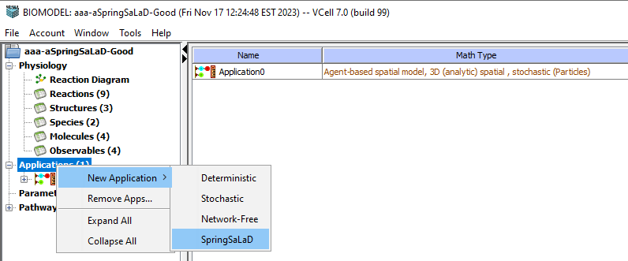

# Introduction to SpringSaLaD Modeling

SpringSaLaD is a particle-based, spatially resolved, stochastic simulator. Where a
[rule-based](RuleBasedTheory.md) model treats a molecule as a set of sites that can bind and change
state, a SpringSaLaD model also gives every one of those sites a place, a size and a speed:
molecules are built as spheres joined by stiff springs, they diffuse and collide in a box divided by
a flat membrane, and reactions happen when two binding sites approach within a binding distance with
a probability determined from the specified rate constant.

It is aimed at the middle ground between molecular dynamics and stochastic simulators where
molecules and species are approximated as points in space. In SpringSaLaD, sites are typically 1 to
10 nm in diameter, standing for functional protein domains; systems may be simulated for tens to a
few thousand particles with time scales of about a second. Excluded volume, tethering, and the
distance between one domain from another are all represented, which is what makes it the right tool
for questions like ligand-mediated receptor clustering, where the geometry of the complex may affect
the system behavior.

In VCell this is an **Application** - see [SpringSaLaD Application](LangevinApp.md) - built on a
rule-based Physiology and solved by the Langevin solver. The same rule-based Physiology may be
compared to simulation results from a deterministic or network-free Application; however, the
reverse is not true: currently, not every rule-based Physiology is compatible with SpringSaLaD.

**Molecules, sites and links.** A molecule is a collection of spherical sites joined by stiff,
unbreakable springs. Each site carries:

- a **radius**, in nm, which enforces excluded volume - two sites cannot overlap;
- a **diffusion rate**, in um2/s;
- a **color**, used only by the [3D Trajectory viewer](SSResults.md);
- a **position** within the molecule, as x, y and z in nm;
- zero or more **states**, which is where the biochemistry lives - e.g. a kinase domain that is on
  or off, a binding domain with and without its ligand, a residue phosphorylated or not.

The **links** between sites in molecules are stiff springs. They do not break, so they describe the
covalent architecture of the molecule rather than any of its chemistry: a linear chain, a branched
star, a ring.

**Anchors and the membrane.** A molecule that sits in the membrane must carry an inert site named
**Anchor**, whose only job is to tether the other sites to the surface. The name is reserved, and so
is its single state, also called Anchor. The Anchor site can be assigned a 2D diffusion coefficient,
while the other tethered sites diffuse in constrained 3D - see
[SpringSaLaD Species](../BioModelApplications/Specifications/SSSpeciesSpecifications.md).

**Reactions.** A SpringSaLaD reaction is an ordinary reaction rule that VCell has recognised as one
of five kinds. The kinds, and the restrictions that come with them, are described in
[SpringSaLaD Reactions](../BioModelApplications/Specifications/SSReactionsSpecifications.md):

- **Creation** - a zeroth order reaction that makes a new molecule out of nothing, in uM/s.
- **Decay** - a first order reaction that destroys a molecule, in 1/s. Creation and decay together
  are how a species may be fixed at a roughly constant concentration.
- **Transition** - a first order change of a site's state, in 1/s, optionally conditional on whether
  that site is bound.
- **Allosteric** - a state change at one site conditioned on the state of another site in the same
  molecule.
- **Binding** - a second order reaction, in 1/uM/s, that creates a spring (i.e. bond) between two
  sites on different molecules. Binding reactions must be reversible (although the reverse rate may
  be 0); the other four must not be.

**When is SpringSaLaD the right tool?** Use it when the answer depends on both the sizes and
locations of molecular species:

- when excluded volume matters - crowding, or a site shielded by the rest of its own molecule;
- when the membrane tether matters - a kinase that can only reach a substrate it is anchored near;
- when the question is about complexes and aggregates - cluster sizes, how many molecules end up in
  the largest aggregate, how that changes with valency or during signaling;

**When it is not.** Every particle is tracked individually and every pair is tested for collision,
so simulation time grows quickly with particle number. A model of tens of thousands of molecules, or
one that has to run for minutes of simulated time, belongs in a [network-free](NFSimApp.md) or
deterministic application instead. Nothing is lost by trying the less computationally costly
approaches: they are all Applications based on the same Physiology.

**Where to start.** Create a Physiology with 3 Structures: Extracellular, Membrane and
Intracellular. Build the molecules and rules containing reaction types supported by SpringSaLaD;
then create a SpringSaLaD Application. It supplies the geometry itself, and its
[Molecular Structures](../BioModelApplications/Specifications/SSSpeciesSpecifications.md) tab is
where the molecular structure detail goes.
