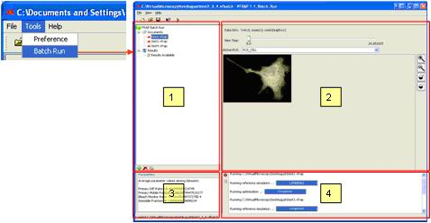
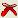
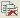
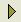
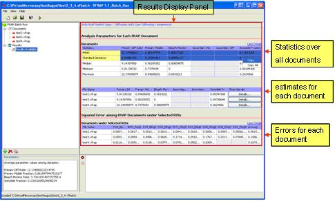
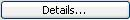

# The Virtual FRAP Batch Run Mode

The virtual FRAP batch run mode is created for users, who have conducted same experiments multiple
times and want an average result over all experiments.

## Starting the Virtual FRAP Batch Run Mode

Clicking on menu **Tools -\> Batch Run** in the main user interface to start the Virtual FRAP batch
run mode. Figure 3-15 shows the batch run mode user interface. The batch run interface has four
components. They are,

1.  The Virtual FRAP batch run navigator – The tree structure lists all the FRAP documents in a
    batch run and also a link to results display when results are available. A toolbar at the end of
    the navigator window provides functions such as “Add a document”, “Delete a document” and
    “Delete all”.
2.  FRAP Image Viewer – It displays the FRAP image based on the time series.
3.  Results Panel – It shows the average parameter values over all the FRAP documents in a batch
    run.
4.  Job Status Panel – It shows job status while batch run is executing.

*Figure 3-15 The Virtual FRAP Batch Run Mode*

## Adding a Document to Virtual FRAP Batch Run

Click on the “Add a New Document” button , a wizard is
popped up. This wizard basically is a combination of the “Load FRAP data” wizard and “Define ROI”
wizard in the main interface. The only difference is that the “Add a New Document” wizard in batch
run allows loading a “.vfrap” document. To understand how to load a FRAP experimental data and how
to Define ROI, please refer to [Loading FRAP Experimental Data](VFrapLoadingData.md) and [Defining
Regions of Interest](VFrapDefiningROIs.md).

After adding a new document into the batch run, the new document’s name will appear in the batch run
navigator tree. Upon selection of a document tree node, the image data related with the document
will appear in the image viewer.

## Deleting Document(s) from Batch Run

To delete a document from the batch run, two steps have to be taken. Firstly, select the document
from the batch run navigator tree. Then, click on the “Delete a Document” button
. The selected document will be deleted from the batch run.
If there are batch run results available, the results will be updated automatically. The results
will be unavailable if there is no document left in the batch run.

If users want to delete all the documents in the batch run, they just need to click on “Delete All
Documents” button. All the documents and available
results will be removed from batch run.

## Executing Batch Run

When all the documents for a batch run are added, users can start executing a batch run by clicking
the batch run  button in the toolbar of the batch run
interface. A selected model type wizard will be popped up before proceeding to batch run. Users are
required to select only one possible FRAP model for the batch run. To understand choosing a FRAP
model, please refer to [Selecting FRAP Model](VFrapSelectingModel.md).

The batch run basically does estimation of parameters of selected model for each document involved
and summarized over all the documents. The running job statuses are updated in the job status viewer
simultaneously. Once the results are available, the results node will be updated in the batch run
navigator.

## Understanding Batch Run Results

When the results are ready, a “Results Available” node will be added to the navigator tree. Clicking
on the tree node, the results display panel will be shown on top of the image viewer. Figure 3-16
shows results display panel.

*Figure 3-16 Virtual FRAP Batch Run Results Panel*

The batch run results panel has three tables. The one on top of the panel is the table showing the
statistics over all the documents in a batch run. The statistics are mean, standard deviation,
median, minimum and maximum of different parameters in a model.

The table in the middle lists all the estimated parameter values for each document. Clicking on the
details button  will lead users to an estimate
parameters panel, which users may refer to [Estimating Parameters](VFrapEstimatingParameters.md).

The table at the bottom shows errors for each document calculated under selected ROIs. All the
tables are able to be partially or wholly copied to clipboard to paste into other applications.
