# Defining Regions of Interest

In virtual FRAP, spatial data are summarized under regions of interest in order to speed up the
parameter estimation process. Regions of interest are generated based on three primary regions of
interest. They are Cell ROI, Bleached ROI and Background ROI. The “Define ROI” wizard is designed to
lead users through the process of creating primary regions of interest, which includes cropping
images, defining cell ROI, defining bleached ROI, defining background ROI and selecting regions of
interest for error calculation in optimization. Each step is highlighted on top of the wizard page.
To start the “Define ROIs” wizard, users just need to click on the second button
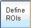 in the “Data Analysis Work Flow”.

## Cropping FRAP image data

It is highly recommended to apply cropping to any raw image data to remove unnecessary information
in order to speed up the performance. Figure 3-6 shows cropping of a FRAP image.

- **Custom Crop** – Clicking on the crop button 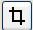 allows the
  user to click on the image and drag the mouse to draw the desired rectangular crop window.
- **Automatic Crop** – Clicking on the automatic crop button
  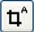 creates a crop window that can be used as a default
  crop window.

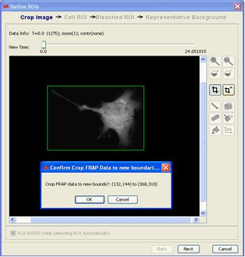

*Figure 3-6 Cropping a FRAP Image Data*

## Defining regions of interest

The toolbar functions in the image viewer are all enabled when the wizard page navigate to the
defining cell/bleached/background ROIs steps. Users are able to manually draw the ROIs on FRAP
images by using Drawing Toolbox or to define ROI automatically by using ROI Toolbox. Once the
primary ROIs are defined, Virutal FRAP will automatically generate eight ROI rings to summarize
spatial data. Figure 3-7 shows creating a cell ROI automatically with “ROI Assistant” in the “Define
ROI” wizard.

### Defining ROIs manually

- **Draw ROI area** – Once the paintbrush button  is pressed,
  the paint mode will be on until another button is selected. When you drag the mouse over the image
  in the paint mode, the area the mouse has passed will be highlighted and saved as the specified
  ROI. The files open with brush as the default selection.
- **Erase ROI area** – Select the erase mode by clicking on erase button
  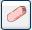. Dragging the mouse over a painted area will erase the
  part that the mouse has passed.
- **Fill ROI area** – Select the fill mode by clicking on erase button
  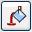. If users click the mouse again in a closed area, the area
  will be automatically filled.

### Defining ROIs automatically

- **Clear ROI** – Clicking on the clear ROI button 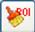 will
  clear the selected area for the current ROI.
- **ROI time course** – Clicking on the time plot ROI button
   will pop up a dialog showing the plot of the average
  intensity of all the pixels in the area of the current ROI against time.
- **Import ROI mask** – Clicking on the import ROI mask button
   will pop up an open file dialog. Users can select
  an image file to import the ROIs that is defined in the file. The imported file must have the same
  size of the current image data. The primary ROIs defined in the imported file will be copied to
  the current file.
- **ROI assistant tool** – Clicking on the ROI assistant button
  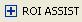 will pop up an ROI assistant dialog. Users have to
  make decisions on selecting ROI threshold source and spatial enhance threshold. Users can also
  play on the slider bar to shrink ROI or grow ROI. The FRAP image will be changed simultaneously
  when users are tuning the thresholds. Once the automatically generated ROI is accepted, users can
  click on the resolve button 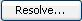 to have the image resolved.
  The fill voids button 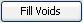 will be enable if any void
  pixels exist in the ROI area that are required to be filled up. Once the created ROI is ready,
  apply ROI button 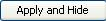 will be enabled. Users can click on
  that button to apply the current ROI.

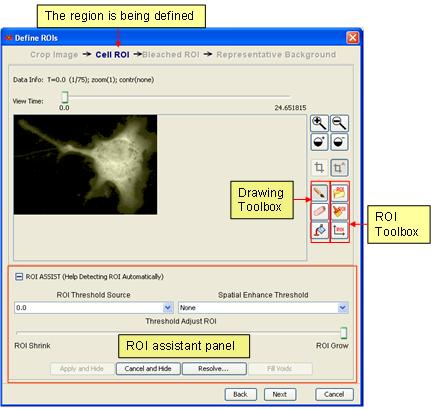

*Figure 3-7 Creating a Cell ROI using ROI Assistant*

## Selecting regions of interest for error calculation

The last page of the “Define ROIs” wizard shows the generated ROI rings based on the primary ROIs.
Users can select any numbers of them by clicking on the checkbox which specifies the different
rings. The generated ROI rings are displayed in different colors. Figure 3-8 shows the ROI selection
page.

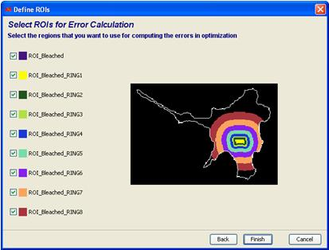

*Figure 3-8 Selecting ROIs for Error Calculation*
