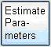
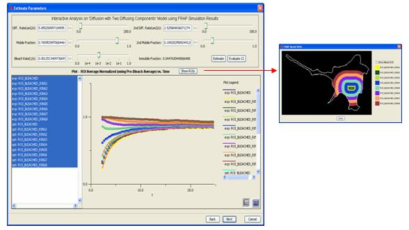
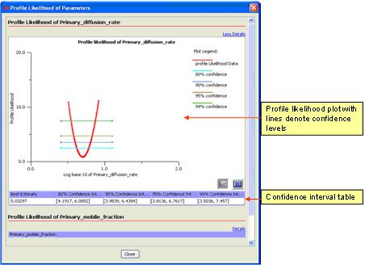
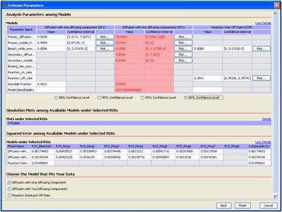

# Estimating Parameters

The traditional FRAP fitting is usually done based on the bleached area for a single diffusion rate.
The Virtual FRAP is able to fit more accurately by taking the spatial data into account. The fitting
is conducted over all the selected ROI rings instead of only bleached area. Moreover, the Virtual
FRAP is able to deal with a secondary diffusion rate.

The estimated parameters for one diffusing component are primary diffusion rate, primary mobile
fraction and bleaching while monitoring rate. The estimated parameters for two diffusing components
are primary diffusion rate, primary mobile fraction, secondary diffusion rate, secondary mobile
fraction and bleaching while monitoring rate.

The last step of data analysis work flow is to estimate diffusion parameters. To start the
estimation wizard, users need to click on the “Estimate Parameters” button
. A spatial reference simulation is then started
and followed by optimization. The best estimates are acquired by minimizing the errors between the
simulated data and the experimental data.

## Understanding the best estimates

Once the simulation and optimization is completed, the results for selected models will be shown in
the different wizard pages. Figure 3-10 shows the estimate results page for two diffusing
components. The top half of the page displays the best estimates for such a model. The bottom half
is a real-time plot which illustrates the difference between simulated data and experimental data
according to the parameter changes.

In this page, users are able to tune a primary diffusion rate together with a secondary diffusion
rate and the bleach while monitoring rate. Users can set values either by typing into the text
fields or tuning the slider bars. The different colors of the plots represent how the diffusion
works in different ROIs of the cell. Clicking on the show ROIs button
 will show the ROIs distinguished by different colors.
Users can click on the best fit button  to get the
best fit parameters based on the current parameter initials in the text fields.

In addition, the Virtual FRAP evaluates the confidence intervals for each parameter. By clicking
evaluate confidence interval button , the evaluation
then starts and the results will be shown in the confidence interval panel shown in Figure 3-11. The
confidence interval panel contains several plot panels, one for each parameter. All the plot panels
are able to be expanded or collapsed and the default plot is for primary diffusion rate. Users can
click on  to expand a specific plot panel or
 to collapse a specific plot panel.

The x-axis in the plot is the log base 10 ratio of parameter value and the y-axis is the likelihood
of the simulated results. The Virtual FRAP has built in confidence levels which are 80%, 90%, 95%
and 99%. Horizontal lines with different colors denote different confidence levels in the plot. At
the bottom of the confidence plot, a table listed the confidence intervals according to the
confidence levels.

*Figure 3-10 Parameter Estimation Results for Two Diffusing Components*

*Figure 3-11 The Confidence Interval Panel*

## Model parameter comparison and best model selection

The last page of “Estimate Parameters” wizard is a summary page. The page has four parts. Firstly, a
table lists all estimates for one or two models according to the selection. This is visible by
default. Secondly, a plot contains all the plots for experimental data and simulated selected model
data, which is invisible by default. The third part is a table showing errors between experimental
data and simulated data under each ROI for selected models. The last part allows users to choose the
best model base on their judgement, however, a machine made decision will be given by default. The
summary page is illustrated in Figure 3-12.

*Figure 3-12 The Summary Page in “Estimate Parameters” Wizard*
