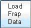
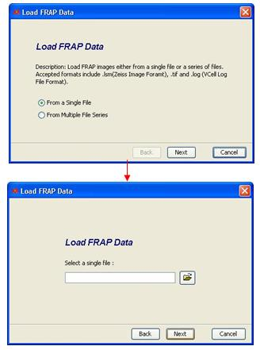
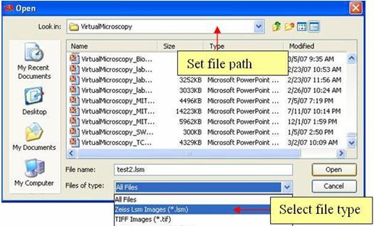
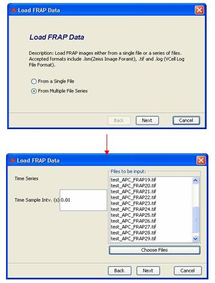
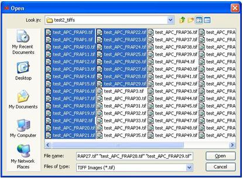

# Loading FRAP Experimental Data

The first step of FRAP data analysis is to load raw experimental data. The data can be loaded either
from a single file or a file series. It is displayed in the image viewer after loaded successfully.

## Loading data from a single file

Click on the Load Frap Data button  , a "Load Frap
Data" wizard is popped up. Follow the wizard page choose "From a single file". In the next page,
click on  button to start an open file dialog to load data
from a single file. Choose the file path and select the appropriate format. FRAP data can be loaded
from different sources. Figure 3-2 shows how to load a single file from "Load Frap Data" wizard and
Figure 3-3 shows the open file dialog. Virtual FRAP is able to load following files.

1.  Images - More than 50 image file types are supported in Virtual Frap by using Bio-Formats
    library (detailed information about supported image file types can be found in
    <http://www.loci.wisc.edu/ome/formats.html>). Zeiss lsm and TIFF image formats are both
    available in “Files of Type”. To load image types other than “.lsm” and “.tif”, users need to
    choose “All Files” as file type.

2.  Virtual Cell Simulation Log files - VCell simulation result data are retrievable from a “.log”
    file. By opening the VCell log file and selecting a specific variable, the spatial results will
    be loaded as initial FRAP data. To see the log files, users need to choose “All Files” as file
    type.

*Figure 3-2 Loading a Single File in "Load FRAP Data" Wizard*

*Figure 3-3 Opening a Single File Dialog in Virtual FRAP*

## Loading data from file series

Click on the Load Frap Data button  to open the "Load
Frap Data" wizard. On the first wizard page choose "From Multiple File Series ". In the next page, a
file series input dialog is showed up to load file series (e.g. a time series of FRAP experiment
images). Users have to specify the time interval between images for the time series data. The
“Choose Files” button will lead users to an open file dialog which allows users to select multiple
files. The file types are the same image file types supported by Bio-Formats as mentioned above.
Figure 3-4 shows how to load multiple files from "Load Frap Data" wizard and Figure 3-5 shows the
dialog to open multiple files.

*Figure 3-4 Loading Multiple Files in "Load FRAP Data" Wizard*

*Figure 3-5 Opening Multiple Files Dialog in Virtual FRAP*

## Adjusting FRAP image data

In the Virtual FRAP image viewer, there are buttons provide basic image processing functions, which
enable users to have a detailed look at the data. The functions are described below.

- **Zoom in** – Clicking on the zoom in button  will make
  the image one size bigger with each click.
- **Zoom out** – Clicking on the zoom out button  will make
  the image one size smaller with each click.
- **Increase contrast** – Clicking on the increase contrast button
   will make the image contrast one unit bigger
  with each click.
- **Reduce contrast** – Clicking on the reduce contrast button
   will make the image contrast one unit smaller
  with each click.
