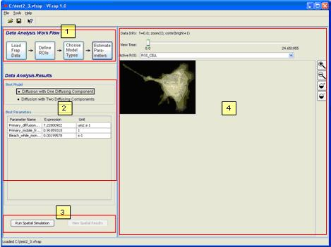

# Quick Tour of Virtual FRAP

Virtual FRAP estimates and evaluates diffusion rates from FRAP experimental data in four steps. The
four steps are intuitively guided through a wizard-based work flow:

- Loading FRAP experimental data.
- Defining regions of interest (ROI).
- Selecting diffusion model which can either be a single diffusing component model or two diffusing
  components model.
- Estimation of a primary diffusion rate and an optional secondary diffusion rate.

## Virtual FRAP Main Interface

Figure 3-1 illustrates the Virtual FRAP 1.0 main user interface. It contains the raw FRAP data, the
data analysis workflow, the best results and the spatial simulation all in one frame.

1.  **Data Analysis Work Flow** - Wizard based work flow guides users through the whole process from
    loading raw data to getting estimation results.
2.  **Data Analysis Results Panel** - It shows the best model and the model parameter values that
    fits the FRAP dataset.
3.  **Spatial Simulation Toolbox** - It runs the 2D spatial simulation based on the FRAP image with
    the estimated parameters and shows the simulation results together with the original data.
4.  **FRAP Image Viewer** - It displays the FRAP image based on the time series.

*Figure 3-1: The Virtual Frap User Interface*
