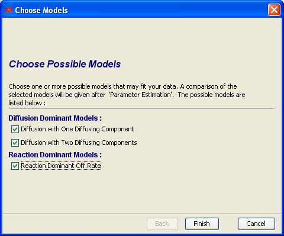

# Selecting FRAP Model

After loading the FRAP image and setting up all the required ROIs, users can proceed to select
possible models that may fit the data. VFrap 1.1 supports two types of models: diffusion dominant
and reaction dominant. There are two available models of diffusion dominant type: diffusion with one
or with two diffusing components. The only available model of reaction dominant type is the reaction
off rate model. Users can choose one or more of these model types. The “Choose Model Type” wizard
has only one page. To select the model users just need to check the checkbox related to the specific
model type. Figure 3-9 shows the wizard.

*Figure 3-9 Choose Models Wizard in Virtual FRAP*
