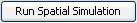
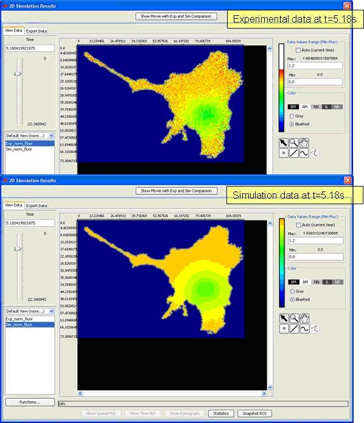
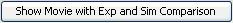
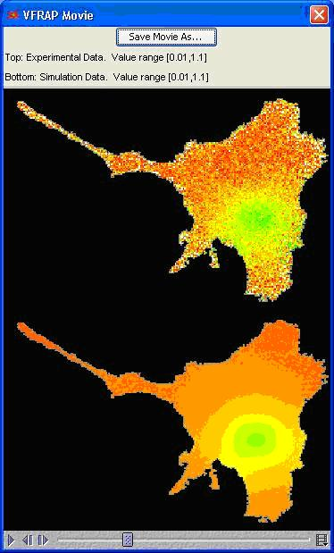

# Spatial Simulation and Results

As shown in Figure 3-1, the results of the selected model after parameter estimation will be shown
in data analysis results panel. Once the analysis results are available, the run simulation button
 is enabled. Clicking on the button will run the
spatial simulation with the selected model parameter set. A spatial viewer will then pop up to show
the results. The default view contains only normalized experimental data and normalized simulation
data, which is convenient for a comparison between them. However, users can choose other views by
selecting other items in the combo-box. Figure 3-13 shows the spatial viewer.

To understand and access spatial simulation results and export the results. Please refer to Virtual
Cell documentation at <http://vcell.org/userdocs/Rel/user_guide.pdf> for chapter 8 and chapter 9.

*Figure 3-13 The Spatial Data Viewer of Virtual FRAP*

There is one feature that worth highlighting in the spatial viewer. Just by a button clicking on
, the Virtual FRAP can generate a movie using normalized
experimental data and simulation data to illustrate how these two sets of data change against time.
The movie viewer is shown in Figure 3-14.

*Figure 3-14 The Movie of Experimental and Simulation Data Comparison*
